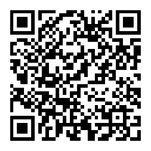

# SEIKO Style デジタル置時計アプリ (iPhone / PWA 対応)

写真の SEIKO 電波デジタル置時計（カレンダー・六曜・温湿度計付き反転液晶クロック）を忠実に再現した、iPhone / iPad 向けの卓上デジタル時計アプリです。  
**iPhone の GPS 位置情報と気象庁（JMA）公式アメダス実測データと連携し、現在地のリアルタイムな気温・湿度を自動取得して表示**します。

👉 **公開 URL**: [https://itou0408.github.io/DigitalClock/](https://itou0408.github.io/DigitalClock/)

   
  <b>▲ iPhoneのカメラで読み取って即アクセス</b>

---

## iPhone へのインストール・使い方 (PWA)

Mac や PC への接続、専用アプリのダウンロードは一切不要です。iPhone の Safari から数タップでホーム画面にインストールして、URLバーやボタンのない**完全な全画面アプリ**として起動できます。

### 1. インストール手順（1分で完了）

1. **Safari で開く**:  
   iPhone の **Safari** で `https://itou0408.github.io/DigitalClock/` を開きます。
2. **ホーム画面に追加**:  
   画面下部の **「共有ボタン」**（四角から上矢印のアイコン）をタップし、メニューから **「ホーム画面に追加」** を選択します。
3. **追加を確定**:  
   右上の **「追加」** をタップすると、ホーム画面に緑色の「卓上時計」アイコンが作成されます。

### 2. 卓上時計としての使い方

1. **ホーム画面から起動**:  
   作成された「卓上時計」アイコンをタップすると、Safari のナビゲーションバーが消え、単独の全画面アプリとして起動します。
2. **位置情報を許可**:  
   初回起動時に「位置情報の利用」を求められたら **「Appの使用中は許可」** を選択してください。  
   現在地の最寄りアメダス観測所から最新の実測気温・湿度が自動取得・反映されます。
3. **横向き設置**:  
   iPhone の画面縦向きロックを解除し、横向き（充電スタンドや MagSafe スタンド等）に置くと、写真同様の迫力ある置き時計になります。

---

## 主な機能

- **SEIKO 風リアル液晶デザイン**:
  - リアルなベゼルフレーム、反転液晶ディスプレイ、電波受信マーク（RADIO CONTROLLED）を再現。
  - DSEG 7セグメントデジタルフォントによるシャープな時刻・秒数表示。
- **気象庁アメダス連動・温湿度計**:
  - 全国 1,280箇所以上のアメダス観測所から、現在地に最も近い観測所を自動特定。
  - 最新の気温（0.1℃単位）・湿度（1%単位）を自動同期（10分ごとに自動更新）。
  - 画面上部に観測地点名（例: `札幌 13.1℃ / 74% 17:40観測`）を表示。
- **フルカレンダー & 六曜自動計算**:
  - 年・月・日・日本語漢字曜日（日〜土）の表示。
  - 独自アルゴリズムによる「大安」「友引」「先勝」「先負」「赤口」「仏滅」の六曜自動計算。
- **スリープ防止（常時点灯モード）**:
  - Screen Wake Lock API に対応。卓上に置いている間、画面が自動消灯・ロックされずに時計を表示し続けます。
- **夜間ディマー（輝度調整）**:
  - 就寝時や暗い部屋でも眩しくないよう、画面全体の明るさをスライダーで無段階調整可能。
- **カラーテーマ切替**:
  - クラシックグリーン（標準）、アンバー（オレンジ）、シアンブルー、ダークモノクロの4色を用意。
- **安心の手動フォールバック**:
  - GPS が取得できない屋内環境やオフライン時でも、主要都市プリセット（東京・札幌・大阪・福岡等）の選択や、温湿度の手動スライダー調整が可能。

---

## 設定メニューの使い方

画面をタップすると、右上に小さな歯車アイコン（⚙）が表示されます：

- **テーマ切替**: 4つのカラーバリエーションから選択
- **明るさ**: スライダーで全体の輝度を調整
- **スリープ防止**: 画面常時点灯（Wake Lock）の ON / OFF
- **GPS気象連動**: 自動取得の ON / OFF、および主要都市の個別選択
- **表示形式**: 24時間制 / 12時間制（AM/PM）の切替
- **手動温湿度**: スライダーで自由な数値をセット可能

---

## 技術構成

- **フロントエンド**: HTML5, CSS3, JavaScript (Vanilla ES6+)
- **フォント**: DSEG (7-Segment Digital Font), M PLUS 1p
- **PWA**: Web App Manifest (`manifest.json`), Service Worker (`sw.js`) によるオフラインキャッシュ
- **API**:
  - 気象庁 (JMA) AMeDAS JSON データ
  - Open-Meteo Weather API
  - W3C Screen Wake Lock API
  - Geolocation API
